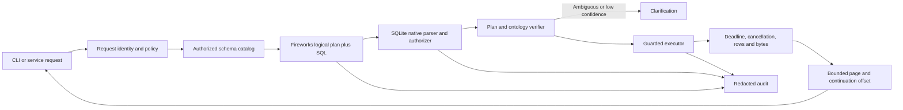

# Governed Fireworks Text-to-SQL Production Candidate

This folder is an isolated hardening of the original take-home project. The
original project, benchmark artifacts, and bundled database remain unchanged.
The historical `QA_PRODUCTION_READINESS.md` report is the baseline assessment
that drove these changes; it is not a claim that all production release evidence
has now been collected.

## What changed

- Replaced the retired Kimi K2.6 default with the configured DeepSeek V4.1 Flash
  migration target and fail-closed retired-model validation.
- Added explicit model request timeout, total model deadline, bounded retries,
  and retryable-error classification.
- Added a versioned data-source profile with schema fingerprint, matching
  documentation, business ontology, and optional table/column allowlists.
- Replaced prefix and semicolon checks with SQLite's native parser and authorizer.
- Added deterministic logical-plan-to-SQL verification and clarification on
  ambiguity or low confidence.
- Added a SQLite progress deadline, cancellation, read-only authorizer, row cap,
  byte cap, incremental fetch, and safe pagination.
- Added question and SQL hashing plus structured JSON Lines audit events. Raw
  questions, result rows, and SQL literals are not written to the audit log.
- Added a service boundary that creates a separate read-only SQLite connection
  and agent for every concurrent request.
- Added credential-free regression tests for the QA P0 failure modes.

## Runtime architecture



The LLM proposes a logical plan and SQL. Deterministic code controls
authorization, schema compatibility, concept mappings, limits, execution, and
auditing.

## Important boundaries

### Data-source onboarding

`data/database_profile.json` binds the bundled database to:

- A stable schema fingerprint
- A specific documentation directory
- Schema, documentation, and ontology versions
- Approved business-concept-to-column mappings
- Optional authorized tables and columns

Selecting another database requires a matching profile. Startup fails if the
live schema fingerprint does not match, so bundled financial documentation
cannot silently ground an unrelated customer database.

### Semantic verification

The model must return:

- Intent and entity grain
- Required tables and columns
- Business concepts
- Unresolved ambiguities
- Clarification question
- Confidence
- SQL

The verifier checks that the native SQLite parser observed the required tables,
columns, and approved concept fields. For example, a plan using the `region`
concept must use `district.A3`; executable SQL filtering on `district.A2` fails
verification and enters the bounded repair path.

This catches plan-to-SQL inconsistencies. It cannot prove that a model-created
plan is always the correct interpretation, so held-out quality gates and
abstention remain required before production release.

### Query execution

Defaults:

| Control | Default |
|---|---:|
| SQL statement deadline | 5 seconds |
| Hard rows per page | 200 |
| CLI page size | 100 |
| Serialized result cap | 1,000,000 bytes |
| Model request timeout | 10 seconds |
| Total model deadline | 20 seconds |
| Model retries | 2 |
| Minimum semantic confidence | 0.80 |

SQLite is opened in filesystem read-only mode and `PRAGMA query_only` is also
enabled. The authorizer denies writes, schema changes, attachments, transactions,
and pragmas. A progress handler interrupts slow statements. Rows are fetched in
batches rather than with `fetchall()`.

The parser safely wraps the validated query in an outer bounded query. This
handles semicolons inside string literals and applies `LIMIT page_size + 1` plus
an offset without editing SQL text internally. Type `more` in the CLI to execute
the next page without another model request.

## Setup

```powershell
uv sync --frozen
Copy-Item .env.example .env
$env:FIREWORKS_API_KEY = "<your-key>"
uv run cli
```

Do not disable TLS verification if dependency restoration fails. Use a trusted
package mirror or correct the host trust chain.

## Configuration

| Variable | Default |
|---|---|
| `FIREWORKS_MODEL` | `accounts/fireworks/models/deepseek-v4p1-flash` |
| `FIREWORKS_BASE_URL` | `https://api.fireworks.ai/inference/v1` |
| `FIREWORKS_API_TIMEOUT_SECONDS` | `10` |
| `FIREWORKS_MODEL_DEADLINE_SECONDS` | `20` |
| `FIREWORKS_MAX_RETRIES` | `2` |
| `TEXT2SQL_PROFILE` | `data/database_profile.json` |
| `TEXT2SQL_SQL_TIMEOUT_SECONDS` | `5` |
| `TEXT2SQL_MAX_ROWS` | `200` |
| `TEXT2SQL_MAX_BYTES` | `1000000` |
| `TEXT2SQL_MINIMUM_CONFIDENCE` | `0.8` |
| `TEXT2SQL_AUDIT_PATH` | unset for library use |

The CLI enables `logs/audit.jsonl` by default.

## Usage

```powershell
uv run cli
uv run cli --page-size 50 --max-rows 200 --sql-timeout 3
uv run evaluate
```

## GitHub Pages browser demo

The `docs/` folder contains a Fireworks-only interactive dashboard modeled after
an inference benchmarking suite, with a simpler tabbed presentation:

- Overview
- Live Demo
- Evidence
- Architecture
- Controls
- Roadmap

The live demo accepts a user-supplied Fireworks API key, requests a structured
logical plan and SQL directly from Fireworks, then executes bounded SQL against
the public financial SQLite database in a `sql.js` Web Worker. The key is not
stored in cookies, browser storage, GitHub secrets, or this repository.

Generate public assets and run locally:

```powershell
python scripts/build_demo_assets.py
python -m http.server 8000
```

Open `http://localhost:8000/docs/`.

The Pages workflow at `.github/workflows/pages.yml`:

1. Generates a sanitized question file without gold SQL.
2. Runs all credential-free unit tests.
3. Stages only the dashboard, public database, and dataset license.
4. Deploys through GitHub Pages without an API-key secret.

Enable **GitHub Pages → Source: GitHub Actions** in the repository settings after
the first push.

Use both a database and its matching profile when onboarding another source:

```powershell
uv run cli --database data/customer.sqlite --profile data/customer_profile.json
```

## Service integration

`src/service.py` is the concurrency-safe application boundary. Each
`QueryService.query()` call creates and closes its own SQLite connection and
agent, preventing connection and conversation history reuse between users. A
`policy_resolver` hook can derive per-request table and column permissions from
the authenticated tenant and user.

The CLI is intentionally a single-user session and keeps bounded conversation
history for follow-up questions.

## Tests

```powershell
uv run python -m unittest discover -s tests -v
```

Coverage includes:

- Executable but semantically incorrect SQL
- Ambiguity and confidence-based clarification
- Unauthorized tables and writes
- Semicolons inside SQL literals
- Large-result pagination
- Result byte caps
- SQL deadline and cancellation
- Schema-profile mismatch
- Retired-model rejection
- Audit redaction
- Concurrent connection isolation
- Empty and malformed benchmark inputs

## Remaining release evidence

This is a production-oriented implementation, not a completed production
certification. Release still requires:

- A frozen held-out suite across unseen schemas and customer terminology
- Agreed execution-accuracy and silent-error confidence intervals
- Prompt-injection and authorization escape testing
- Provider 429, 5xx, timeout, and outage drills against the live API
- Sustained production-like P50/P95/P99 load and cost measurements
- Security review of the deployment identity and audit retention policy
- Clean dependency restoration and full test execution on supported operating
  systems

Do not advertise arbitrary-database production support until each database has
completed the profile onboarding and held-out validation process.
